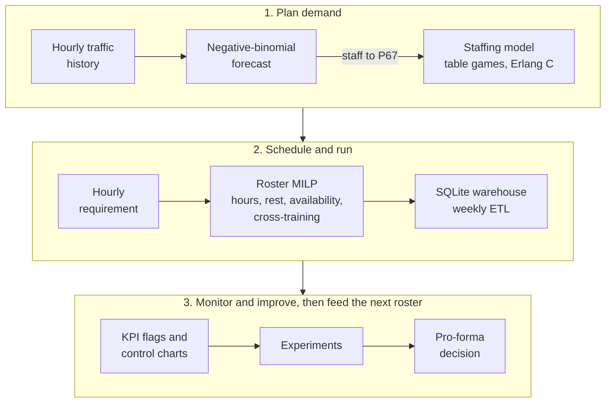
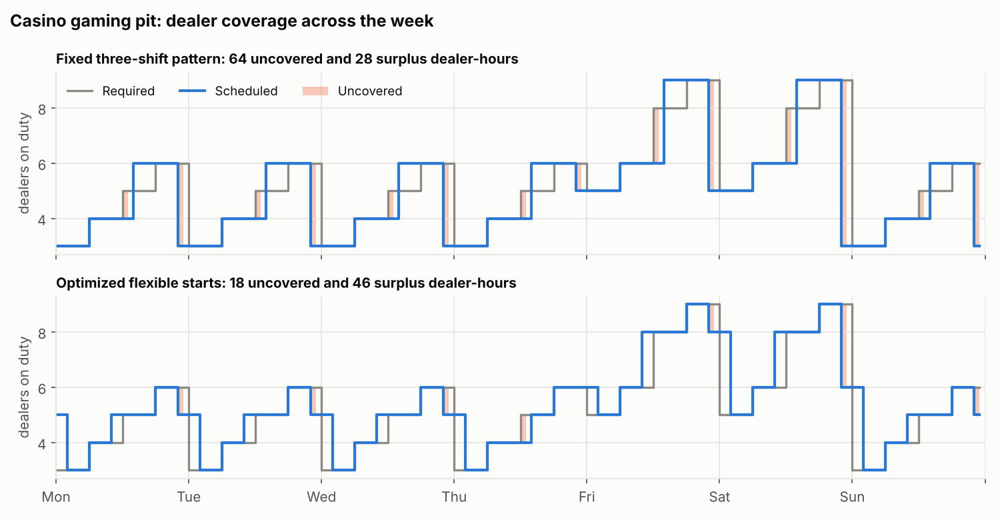
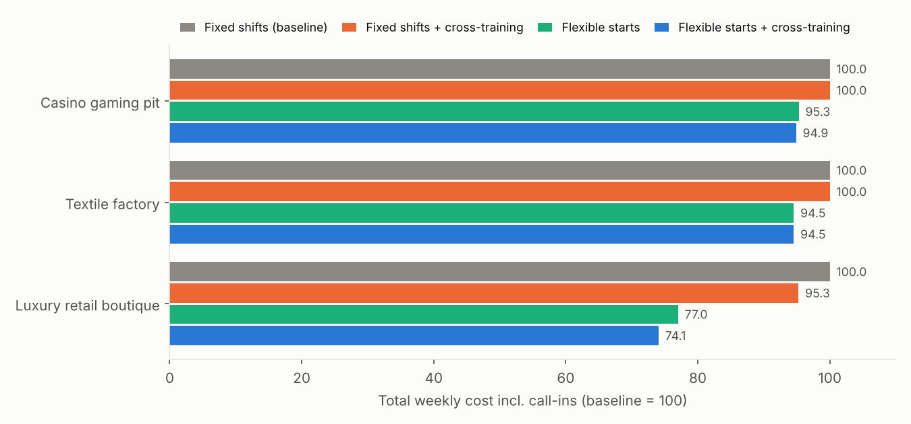
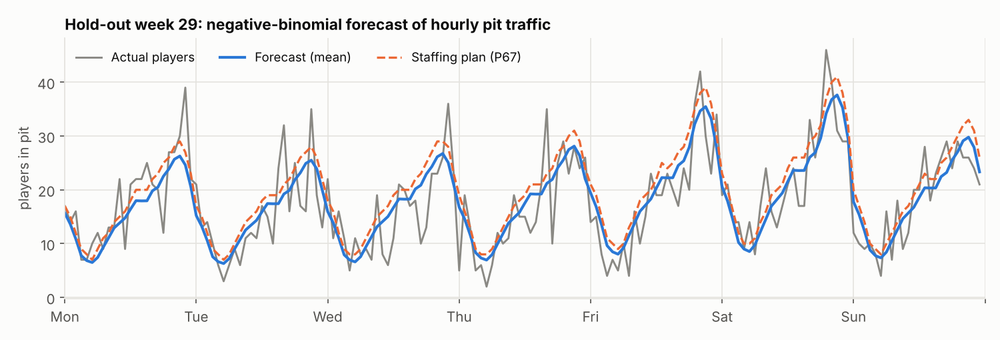
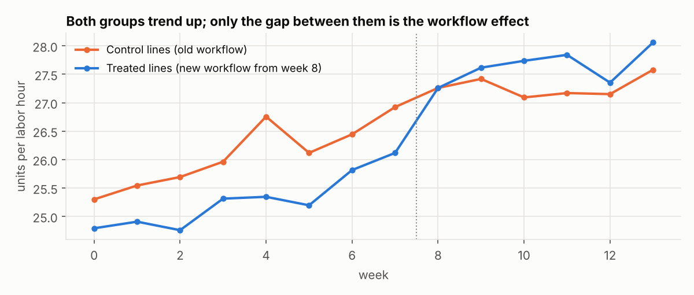
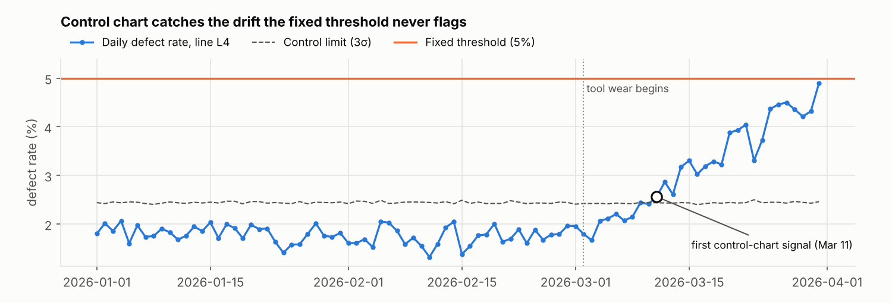

# Labor Optimization

[](https://github.com/Clairechen163/labor-optimization/actions/workflows/ci.yml)


**Author:** Claire Chen

An end-to-end workforce planning toolkit: forecast demand, convert it into a staffing requirement, build the
cheapest weekly roster that respects labor rules, and then measure whether operational changes actually work.
It is applied to three operations with different labor problems: a casino gaming pit (24/7, peak-driven),
a garment factory (round-the-clock production lines) and a luxury retail boutique (service-level driven).

> **Data note.** All data in this repository is simulated with fixed random seeds. No company data is used.
> Simulation is deliberate: every analysis can be checked against the true effect that generated the data.

## Results at a glance

| Question | Method | Result |
|---|---|---|
| How much does an optimized roster save? | Mixed-integer program (PuLP + CBC), ~1,700 binary variables | **5.1%** (casino), **5.5%** (textile), **25.9%** (retail) lower weekly cost than fixed shifts |
| How close to the best possible is it? | Covering-LP lower bound | Casino roster within **0.6%** of the bound; textile matches it |
| What does one more required dealer cost? | Re-solving with each 6-hour block raised by one | From 400 HKD (Thursday morning, absorbed by an existing shift) to 1,760 HKD (any evening, needs a new shift) |
| Can we forecast pit traffic? | Negative-binomial regression, rolling-origin backtest | WAPE **0.235** vs 0.340 for same-hour-last-week |
| How much buffer should we staff? | Newsvendor quantile (call-ins cost 3x) | Staff to P67: under-staffed dealer-hours fall **75 → 49** per week |
| Did +15% dealers speed up the game? | Randomized experiment, clustered OLS | **+5.45 hands/h** (95% CI 4.32–6.58); planted truth +6.0 |
| Did the new factory workflow help? | Difference-in-differences | **+1.18 units/labor-h** (CI 0.64–1.71); naive before/after says 2.36 |
| When is a drifting line caught? | p-chart vs fixed 5% threshold | Control chart **9 days** after drift starts; threshold never fires |
| Is the extra event staff worth it? | Pro-forma with margin, tax and Monte Carlo | +9,000/day after 40% gaming tax (not +17,000); P(loss) 2.9% |

Full tables and figures: [`reports/RESULTS.md`](reports/RESULTS.md). Model statements: [`docs/FORMULATION.md`](docs/FORMULATION.md).

## How the pieces connect



## Key figures

**Roster optimization.** Flexible start times let the schedule follow the demand curve. The fixed three-shift
pattern leaves 64 dealer-hours uncovered each week; the optimized roster leaves 18, at lower total cost.





**Forecasting.** Hourly pit traffic is overdispersed count data, so the forecast is a negative-binomial GLM.
The staffing plan sits above the mean because an uncovered hour costs twice as much as an idle one.



**Evaluation.** Both groups of lines trend upward, so only the gap between them measures the workflow effect.



**Monitoring.** A control chart sets limits from the process's own variation and catches tool wear long before
a fixed threshold would.



## What's inside

| Module | What it does |
|---|---|
| [`roster.py`](src/labor_opt/roster.py) | Employee-level weekly roster MILP: coverage, floor capacity, availability, guaranteed hours (equality), max days, 11-hour rest, weekend limit, overtime, cross-training, call-in pricing |
| [`staffing_lp.py`](src/labor_opt/staffing_lp.py) | Aggregate shift-covering LP: lower bound, plus marginal cost of demand by block |
| [`demand.py`](src/labor_opt/demand.py) | Workload model, Erlang C queueing model with shrinkage, table-game dealer model, theoretical win |
| [`forecast.py`](src/labor_opt/forecast.py) | Negative-binomial GLM forecaster, baselines, rolling-origin backtest scored on staffing error |
| [`casino_math.py`](src/labor_opt/casino_math.py) | Exact house edge and payback (roulette, craps, 8-deck baccarat enumeration, blackjack, poker, slots) with Monte Carlo checks |
| [`kpi.py`](src/labor_opt/kpi.py) | Productivity KPIs, threshold rules with consecutive-period logic, p-chart and X-mR control charts |
| [`experiments.py`](src/labor_opt/experiments.py) | Welch and paired t-tests, clustered regression, difference-in-differences, binomial GLM, power analysis, bootstrap |
| [`proforma.py`](src/labor_opt/proforma.py) | Staffing P&L, break-even uplift, sensitivity grid, Monte Carlo probability of loss |
| [`etl.py`](src/labor_opt/etl.py) + [`sql/schema.sql`](src/labor_opt/sql/schema.sql) | Labor warehouse (employee, schedule, attendance, payroll, performance, training, leave, rules) with cleaning of raw time-clock swipes and compliance views |
| [`pipeline.py`](src/labor_opt/pipeline.py) | Forecast → requirement → roster in one call |
| [`dashboard/app.py`](dashboard/app.py) | Streamlit app: interactive roster optimizer, staffing calculators, KPI monitor, casino math, pro-forma |

Scenario inputs (demand by block, wages, shift templates, workforce, contracts, labor rules) live in
[`configs/`](configs) as YAML, so a new operation is a new config file rather than new code.

## Quick start

```bash
git clone https://github.com/Clairechen163/labor-optimization.git
cd labor-optimization
python -m venv .venv
.venv\Scripts\activate          # Windows PowerShell
# source .venv/bin/activate     # macOS / Linux
pip install -r requirements.txt
pip install -e .
```

```bash
labor-opt schedule casino --out output/      # optimize a roster, write assignments.csv
labor-opt compare retail                     # fixed vs flexible shifts, with/without cross-training
labor-opt forecast                           # forecast -> requirement -> roster
labor-opt casino-math                        # house edge table
labor-opt etl --scenario casino              # build data/warehouse.db and KPI extracts
labor-opt report                             # regenerate reports/RESULTS.md and all figures
streamlit run dashboard/app.py               # interactive dashboard
pytest                                       # 45 tests, about 10 seconds
```

## Modelling choices worth noting

* **Uncovered hours are priced, not forbidden.** Hard coverage makes understaffed weeks infeasible and hides the
  trade-off. Pricing gaps at the cost of call-in staff (3x wage) keeps every scenario solvable and lets the
  optimizer decide when a 2-hour gap is cheaper to fill with a call-in than with a new 8-hour shift.
* **Staffing models must be dimensionally sound.** Retail staffing comes from queueing theory: 500 customers over a
  10-hour day at 10 minutes each is 8.3 Erlangs of work, so about 11 associates are needed on the floor, not 1–2.
* **Before/after comparisons mislead when everything is trending.** In the textile panel the naive test overstates
  the workflow effect by 58%; difference-in-differences recovers it.
* **Sales are not profit.** Counting a casino's extra gaming win as profit ignores the gross gaming revenue tax and
  overstates the value of extra event staff by 89%.
* **Pot odds include the call.** A flush draw with 9 outs (19.6%) facing a 20 bet into a 100 pot needs only
  20/(100+20) = 16.7% equity, so the call is profitable (+3.48 units per call).

## Automation

* [`ci.yml`](.github/workflows/ci.yml) runs the test suite on Ubuntu and Windows for every push.
* [`scheduled-etl.yml`](.github/workflows/scheduled-etl.yml) runs the ETL and report every Monday and uploads the
  warehouse, KPI extracts and figures as build artifacts. It does not commit to the repository.

## License

MIT © Claire Chen
