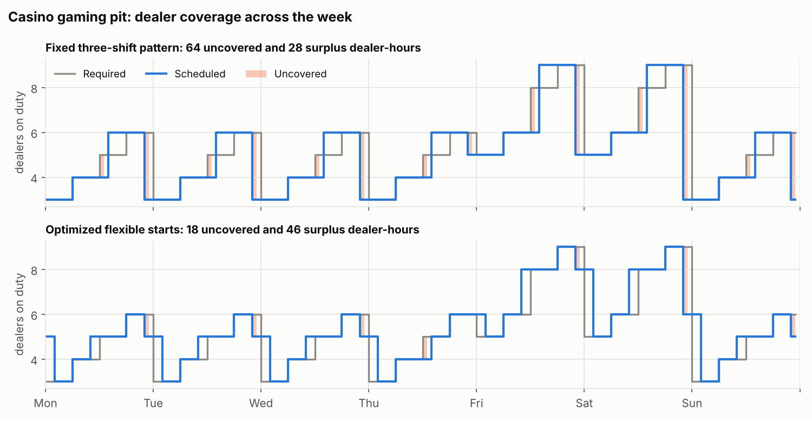
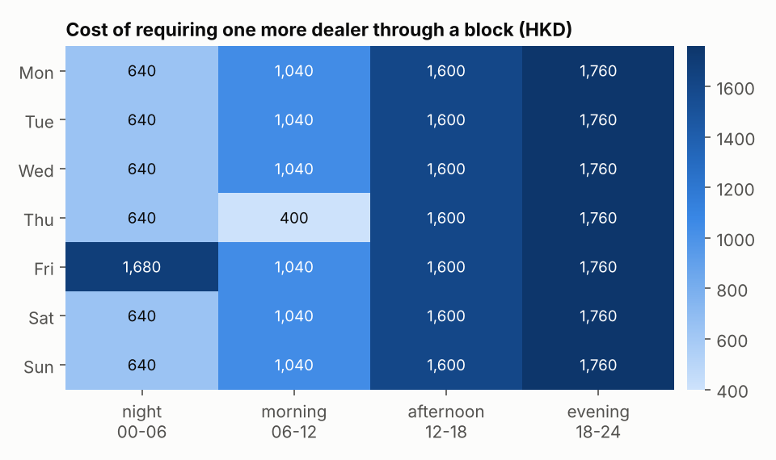
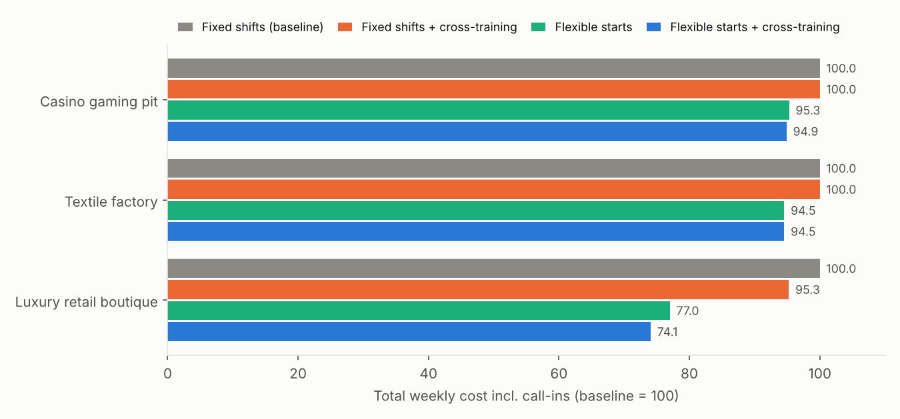
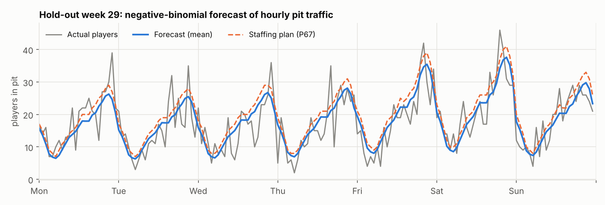
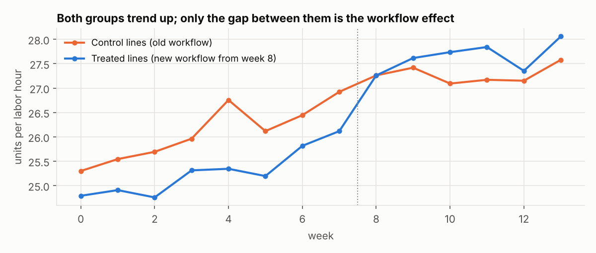
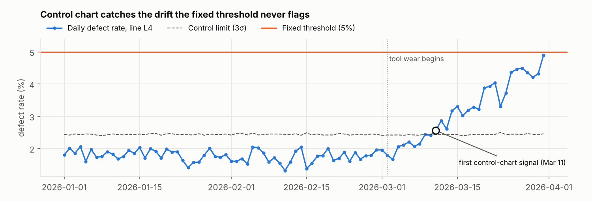

# Results

Generated by `labor-opt report` from the configs in `configs/` and seeded synthetic data. Every number below is reproducible. Currency is HKD unless stated.

## 1. Weekly roster optimization

Total cost = scheduled pay (incl. night premiums and overtime) + call-in cost for any uncovered staff-hours (3x base wage). The covering LP is the same problem without individual employees, so its optimum is a lower bound on any roster.

### Casino gaming pit

50 employees, 1596 required staff-hours per week. Optimized total cost is **5.1% lower** than the fixed-shift baseline (early, swing, grave). The covering-LP lower bound is 353,100; the optimized roster is 0.6% above it, which is the price of individual rules (guaranteed hours, availability, rest).

| Policy | Scheduled pay | Call-in cost | Total cost | Uncovered staff-hours | Efficiency |
|---|---|---|---|---|---|
| Fixed shifts, no cross-training | 326,480 | 47,700 | 374,180 | 82 | 94.6% |
| Fixed shifts + cross-training | 325,280 | 48,900 | 374,180 | 82 | 94.6% |
| Flexible starts, no cross-training | 341,900 | 14,700 | 356,600 | 24 | 94.5% |
| Flexible starts + cross-training (optimized) | 332,900 | 22,200 | 355,100 | 34 | 96.2% |

**Marginal cost of demand.** Re-solving with one more dealer required through each 6-hour block prices the requirement. A block that a lightly used shift can absorb is cheap (Thu morning: 400); one that needs a whole new 8-hour shift is not (Mon evening: 1,760).

### Textile factory

58 employees, 1800 required staff-hours per week. Optimized total cost is **5.5% lower** than the fixed-shift baseline (early, swing, night). The covering-LP lower bound is 343,872; the optimized roster is 0.0% above it, which is the price of individual rules (guaranteed hours, availability, rest).

| Policy | Scheduled pay | Call-in cost | Total cost | Uncovered staff-hours | Efficiency |
|---|---|---|---|---|---|
| Fixed shifts, no cross-training | 295,776 | 67,920 | 363,696 | 138 | 96.2% |
| Fixed shifts + cross-training | 295,776 | 67,920 | 363,696 | 138 | 96.2% |
| Flexible starts, no cross-training | 322,752 | 21,120 | 343,872 | 42 | 93.9% |
| Flexible starts + cross-training (optimized) | 322,752 | 21,120 | 343,872 | 42 | 93.9% |

### Luxury retail boutique

25 employees, 728 required staff-hours per week. Optimized total cost is **25.9% lower** than the fixed-shift baseline (open, close). The covering-LP lower bound is 186,400; the optimized roster is 10.6% above it, which is the price of individual rules (guaranteed hours, availability, rest).

| Policy | Scheduled pay | Call-in cost | Total cost | Uncovered staff-hours | Efficiency |
|---|---|---|---|---|---|
| Fixed shifts, no cross-training | 174,000 | 104,400 | 278,400 | 148 | 90.6% |
| Fixed shifts + cross-training | 174,000 | 91,200 | 265,200 | 132 | 93.1% |
| Flexible starts, no cross-training | 206,000 | 8,400 | 214,400 | 12 | 92.3% |
| Flexible starts + cross-training (optimized) | 203,800 | 2,400 | 206,200 | 4 | 94.3% |

### Value of flexibility, all three operations

## 2. Forecast -> requirement -> roster (casino pit)

30 weeks of hourly pit traffic, rolling-origin backtest over the last 6 weeks. Players are converted to dealers with the table-game model (7 seats, 80% target occupancy, 5 dealers per 4 tables). The plan staffs to the P67 forecast: with call-ins at 3x wage, an uncovered hour costs 2 wages more than a scheduled one and an idle hour wastes 1, so the newsvendor ratio is 2/3.

| Method | WAPE | MAE (players) | Under-staffed dealer-hours/wk | Over-staffed dealer-hours/wk |
|---|---|---|---|---|
| Seasonal naive (same hour last week) | 0.340 | 6.07 | 104.0 | 103.2 |
| 4-week same-hour average | 0.261 | 4.66 | 87.8 | 75.5 |
| NB regression (mean) | 0.235 | 4.20 | 75.5 | 69.7 |
| NB regression (P67 for staffing) | 0.256 | 4.56 | 49.2 | 106.2 |

Rostering the forecast week: total cost 369,740, coverage 97.7%, 5 supervisor shifts redeployed to dealing, solved in 0.5s (2,291 variables).

## 3. Labor demand models

| Model | Inputs | Staff required |
|---|---|---|
| Workload (textile) | 100,000 garments/month, 25/hour, 160 h/worker, 90% efficiency | 28 workers (27.8) |
| Erlang C (retail) | 50 customers/hour, 10 min each, 80% served within 2 min | 11 associates on duty |
| Erlang C (retail) | same, 95% within 2 min, 20% shrinkage | 13 on duty, 17 scheduled |
| Table game (casino) | 300 guests, 40% at blackjack | 22 tables, 28 dealers |

## 4. Evaluating optimization changes

Each dataset has a known planted effect, so the estimates can be checked against the truth.

| Experiment | Planted effect | Method | Estimate (95% CI) |
|---|---|---|---|
| Casino: +15% dealers at peak | +6.0 hands/h | Welch t-test | 5.29 (3.88, 6.70) |
| | | OLS + controls, table-clustered SE | 5.45 (4.32, 6.58) |
| Textile: new workflow | +1.5 units/labor-h | Naive before/after (treated lines) | 2.36 (1.72, 3.01) |
| | | Difference-in-differences | 1.18 (0.64, 1.71) |
| Retail: dynamic staffing | log-odds +0.12 | Binomial GLM, store-clustered SE | 0.120 (0.091, 0.150) |

The naive before/after test credits the common upward trend to the workflow and overstates the effect by 58%; the pre-period trend difference between groups is -0.033/week (p = 0.71), consistent with parallel trends. Retail conversion rises from 19.1% to an implied 21.0%.

**Does the casino change pay?** At 5.94 players per table, HK$500 average bet and a 1% house edge, the extra hands are worth 1,134 theoretical win per peak hour across 7 tables, against 270 of extra dealer pay (net 864; 629 at the lower confidence bound). Detecting a 3 hands/h effect needs 152 table-shifts per arm.

## 5. Tracking productivity and flagging operations

Tool wear starts on line L4 on 2026-03-02. The 5% defect threshold never fires; the p-chart signals on 2026-03-11 (9 days after the drift begins).

Threshold rules from `configs/kpi_thresholds.yaml` flag these units:

| Operation | Unit | Rule | First flagged | Value | Action |
|---|---|---|---|---|---|
| Textile | L4 | downtime_rate > 0.1 | 2026-03-21 | 0.109 | Schedule maintenance |
| Textile | L4 | fulfillment_days > 10 | 2026-03-21 | 10.1 | Re-prioritise orders |
| Retail | S05 | conversion < 0.15 for 3 periods | 2026-04-07 | 0.132 | Sales coaching |
| Retail | S02 | avg_transaction_minutes > 8 for 2 periods | 2026-03-02 | 8.77 | Check POS / checkout |
| Retail | S01 | nps < 65 for 3 periods | 2026-03-04 | 59.5 | Service quality review |
| Casino | DLR-07 | hands_per_hour < 60 for 2 periods | shift 21 | 49.7 | Coaching / break schedule |
| Casino | DLR-09 | utilization < 0.7 for 3 periods | shift 2 | 0.673 | Rebalance shift assignment |
| Casino | DLR-09 | revenue_per_labor_hour < 400 for 3 periods | shift 3 | 380 | Review table assignment |

## 6. Casino mathematics

Exact values (rational arithmetic, or full enumeration of an 8-deck baccarat shoe), checked against Monte Carlo in the tests.

| Game | Bet | P(win) | House edge | Payback |
|---|---|---|---|---|
| European roulette | Straight up (35:1) | 0.0270 | 2.703% | 97.297% |
| European roulette | Red/black (1:1) | 0.4865 | 2.703% | 97.297% |
| American roulette | Straight up (35:1) | 0.0263 | 5.263% | 94.737% |
| American roulette | Top line 0-00-1-2-3 (6:1) | 0.1316 | 7.895% | 92.105% |
| Craps | Pass line (1:1) | 0.4929 | 1.414% | 98.586% |
| Baccarat (8 decks) | Banker (0.95:1) | 0.4586 | 1.058% | 98.942% |
| Baccarat (8 decks) | Player (1:1) | 0.4462 | 1.235% | 98.765% |
| Baccarat (8 decks) | Tie (8:1) | 0.0952 | 14.360% | 85.640% |
| Slot (example paytable) | 1 unit per spin | 0.3749 | 4.000% | 96.000% |

Blackjack: P(natural), 6 decks = 0.0475. Hitting hard 16 busts with probability 0.615 (infinite deck) or 0.592 (single deck, 10-6 vs dealer 7 removed). Poker: a flush draw on the turn (9 outs of 46, 19.6%) facing a 20 bet into 100 needs 16.7% equity, so calling is +EV (+3.48 units).

## 7. Pro-forma: is the extra labor worth it?

Textile training (+10% output, same 50 workers): +1,000/day as stated, +550/day at a 55% contribution margin; labor cost per unit falls from 5.00 to 4.55.

| Case | Incremental profit/day | Break-even uplift | Expected uplift | P(loss) |
|---|---|---|---|---|
| Retail promotion (as stated) | 14,000 | 2.0% | 30% | 0.3% |
| Retail promotion (65% gross margin) | 8,750 | 3.1% | 30% | 0.4% |
| Casino event (as stated) | 17,000 | 3.0% | 20% | 1.6% |
| Casino event (net of 40% gaming tax) | 9,000 | 5.0% | 20% | 2.9% |

Treating sales or gaming win as profit overstates the benefit by 60% (retail) and 89% (casino). P(loss) comes from Monte Carlo over the uncertain uplift (normal, SD 10 points for retail and 8 for the casino). These examples keep the original case study's currency units.
